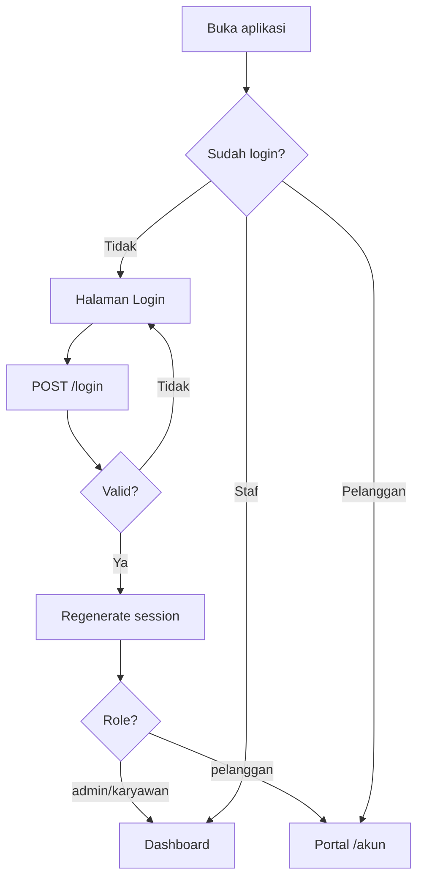
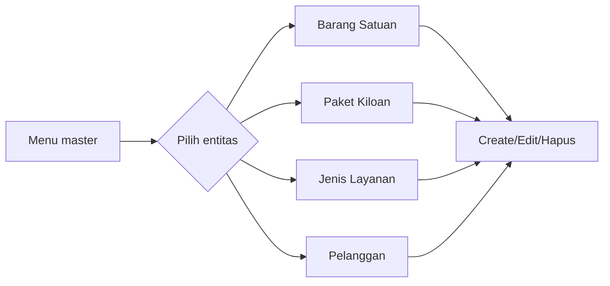
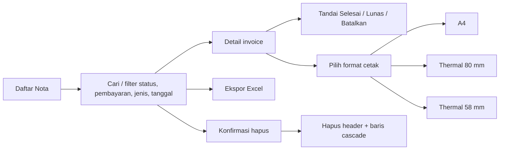
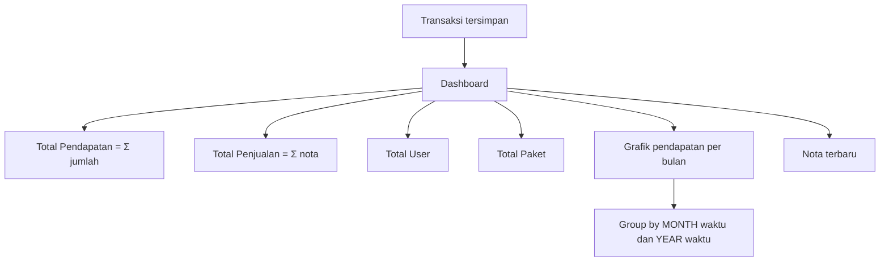

# BUSINESS WORKFLOW — Laundry Management System

Dokumen ini memetakan alur bisnis **aktual** aplikasi: aktor dan hak akses, perhitungan
transaksi, pencetakan invoice, serta konsistensi data.

## 1. Aktor dan Hak Akses

| Aktor | Role | Kemampuan |
|---|---|---|
| Administrator | `admin` | Semua: dashboard, user, karyawan, pelanggan (termasuk kategori), master, transaksi (termasuk status/pembayaran dan hadiah), hapus, ekspor, program loyalitas, promosi, Setup |
| Kasir/Operator | `karyawan` | Dashboard, pelanggan, master (barang/paket/layanan), transaksi (buat/lihat/ubah/cetak, status/pembayaran, pakai hadiah), ekspor; hapus nota, loyalitas, promosi, dan Setup khusus admin |
| Pelanggan | `pelanggan` | Portal `/akun`: ringkasan + daftar nota milik sendiri, detail invoice, unduh PDF; tanpa akses halaman staf |

Aturan ini ditegakkan di server melalui Spatie Permission + Policy (staf) dan middleware
`pelanggan` + filter kepemilikan `pelanggan_id` (portal pelanggan). Karyawan tidak memiliki
permission `loyalitas.manage` dan `promosi.manage`, sehingga menu konfigurasi tidak dirender dan
endpoint-nya menolak dengan 403.

## 2. Alur Login



Satu halaman login untuk semua peran. Pengguna yang sudah login dan membuka `/login` langsung
diarahkan ke tujuan sesuai perannya.

## 3. Alur Master Data (Admin/Kasir)



Aturan:
- Nama barang unik; `jenis_cuci` unik.
- Paket kiloan boleh memiliki nama sama dengan harga/deskripsi berbeda; aplikasi menampilkan
  deskripsi agar kasir dapat membedakan.
- Menghapus master tidak boleh menghapus nota historis (FK `nullOnDelete` + snapshot).
- Karyawan dikelola sebagai user role `karyawan`; pelanggan sebagai user role `pelanggan`.

### 3.1 Kategori pelanggan

Setiap pelanggan memiliki `kategori_pelanggan`:

| Kategori | Arti | Dampak |
|---|---|---|
| `reguler` | Pelanggan umum (default) | Hanya mengikuti promosi bertarget `reguler` atau `semua` |
| `member` | Pelanggan terdaftar program | Mengikuti promosi bertarget `member`/`semua` dan **program loyalitas**; `member_sejak` diisi saat pertama menjadi Member |

- Admin/karyawan dapat mengubah kategori melalui form pelanggan (`pelanggan.manage`).
- Saat status berubah menjadi Member, `member_sejak` diisi tanggal hari ini (atau tanggal lama bila
  sudah pernah Member). Saat kembali ke Reguler, `member_sejak` dikosongkan.
- Hadiah yang sudah diperoleh **tidak dicabut** ketika pelanggan turun ke Reguler; penerbitan hadiah
  loyalitas baru berhenti karena syarat `isMember()` tidak lagi terpenuhi.
- Perubahan kategori memakai sinkronisasi hadiah berikutnya (saat transaksi disimpan/diselesaikan
  atau program/promosi disimpan), sehingga badge dan riwayat lama tetap konsisten.

## 4. Alur Transaksi Paket Kiloan

```mermaid
flowchart TD
    A[Nota → Paket Kiloan] --> B[Pilih pelanggan lewat combobox (default Pelanggan umum) atau isi nama]
    B --> C[Pilih paket kiloan]
    C --> D[Isi berat kg dan waktu]
    D --> E[Server: ambil harga paket]
    E --> F[total_harga = berat × harga_per_kg]
    F --> G[Isi diskon 0-100%]
    G --> H[jumlah = total_harga − total_harga × diskon / 100]
    H --> I[Simpan nota + snapshot harga]
    I --> J[Redirect detail / struk]
```

Rumus (server-side, pembulatan rupiah):

```
total_harga = round(berat × harga_per_kg)
diskon_nilai = round(total_harga × diskon / 100)
jumlah       = total_harga − diskon_nilai
```

Contoh: berat 3,5 kg × Rp25.000 = Rp87.500; diskon 10% = Rp8.750; **jumlah = Rp78.750**.
Pendapatan dashboard memakai `jumlah`.

### 4.1 Status nota, pembayaran, dan hadiah

Berlaku untuk kedua jenis nota (kiloan dan satuan):

| Aspek | Aturan |
|---|---|
| Status nota | `Diproses` (awal) → `Selesai`; nota `Diproses` dapat `Dibatalkan`. Nota `Dibatalkan` tidak dapat diselesaikan, dan pembatalan kedua ditolak |
| Status pembayaran | `Belum Lunas` (awal) / `Lunas`; dapat diubah dari detail nota oleh staf |
| Hitungan loyalitas | Hanya nota berstatus **Selesai** yang dihitung, per pelanggan terdaftar |
| Hadiah | Maksimal **satu** hadiah per nota; hadiah harus milik pelanggan pada nota dan berstatus `Tersedia` |
| Diskon manual | Jika hadiah dipakai, `diskon` manual dipaksa 0 (tidak dapat digabung) |
| Potongan hadiah | `persen` = round(total × min(100, nilai)/100); `nominal` = min(total, nilai); `gratis` = nilai > 0 ? min(total, nilai) : total |
| Nominal akhir | `jumlah = total_harga − potongan` (tidak negatif); `diskon_nominal` menyimpan potongan sebenarnya |
| Audit | `customer_reward_id`, `reward_label`, `nilai_terpakai`, dan `nota_id` pada hadiah menautkan nota ke hadiah |
| Edit nota | Hadiah lama dilepas lebih dulu, total dihitung ulang dari master, lalu hadiah yang dipilih (bila ada) diterapkan kembali — semuanya dalam satu transaksi |
| Batalkan/hapus nota | Hadiah dilepas (kembali `Tersedia` atau `Kedaluwarsa` bila sudah lewat masa berlaku). Bila hadiah dari transaksi tersebut sudah dipakai pada nota lain, pembatalan **ditolak** agar siklus hadiah tidak ganda |

## 5. Alur Transaksi Barang Satuan

```mermaid
flowchart TD
    A[Nota → Barang Satuan] --> B[Pilih pelanggan lewat combobox (default Pelanggan umum) atau isi nama]
    B --> C[Pilih jenis layanan]
    C --> D[Tambah baris barang]
    D --> E[Pilih barang → harga terisi otomatis]
    E --> F[Isi jumlah barang]
    F --> G[total baris = harga × jumlah]
    G --> H{Masih ada baris?}
    H -- Ya --> D
    H -- Tidak --> I[Server: Σ baris + biaya layanan]
    I --> J[total_harga = subtotal + biaya_layanan]
    J --> K[Isi diskon 0-100%]
    K --> L[jumlah = total_harga − total_harga × diskon / 100]
    L --> M[DB transaction: simpan header + semua baris]
    M --> N[Redirect detail / struk]
```

Contoh: Kemeja 2 × Rp10.000 = Rp20.000; Celana Jeans 1 × Rp8.000 = Rp8.000;
layanan "Cepat" Rp15.000 ⇒ total_harga Rp43.000; diskon 5% = Rp2.150 ⇒ **jumlah Rp40.850**.

Aturan validasi:
- Minimal satu baris barang; jumlah barang ≥ 1.
- Barang harus ada di master; harga diambil dari master (bukan input bebas).
- Jenis layanan wajib untuk nota satuan.
- Diskon bilangan bulat 0–100.
- Perhitungan klien hanya pratinjau; server menghitung ulang.

## 6. Alur Detail, Cetak, dan Hapus Nota



- Invoice memuat: logo/nama perusahaan dari Setup, nomor, waktu, nama pelanggan dan kategori,
  jenis, rincian paket/baris, harga, subtotal, diskon/hadiah, total bersih, status nota,
  status pembayaran, dan terbilang Bahasa Indonesia.
- Nomor nota: `#` + 3 huruf kapital + 3 alfanumerik, dijamin unik. Seeder demo memakai pola
  deterministik `#D{YY}{MM}-{NN}`.
- **Pilihan format cetak** muncul sebelum `window.print()`: **A4** (invoice lengkap dengan kop,
  tabel, ringkasan, dan terbilang), **Thermal 80 mm**, dan **Thermal 58 mm** (struk ringkas,
  font 10 px/9 px, nama barang membungkus agar total tidak terpotong).
- Format thermal menyuntikkan `@page size: 80mm <tinggi>mm` / `58mm <tinggi>mm`; tinggi dihitung
  dari tinggi struk + margin halaman agar pratinjau memakai lebar kertas yang benar. Format A4
  memakai `@page size: A4`. Media cetak menyembunyikan sidebar, header, footer, tombol aksi, dan
  modal (`.no-print`), sehingga hasil cetak hanya berisi nota.
- Hapus nota hanya oleh admin (permission `nota.delete`); karyawan tidak melihat tombol hapus.
  Baris ikut terhapus (cascade).
- Ekspor Excel memakai kolom: No Nota, Jenis, Nama Pelanggan, Layanan, Waktu, Berat (kg),
  Harga per kg, Biaya Layanan, Total Harga, Diskon (%), Jumlah, Status, dan Pembayaran.
  Berkas `.xlsx` memuat judul perusahaan, ringkasan filter, header beku, auto-filter, baris
  total, format Rupiah/tanggal, dan pengaturan cetak lanskap A4.

## 7. Alur Dashboard dan Laporan



Pengelompokan memakai `waktu` transaksi (bukan `created_at`) dan menampilkan tahun berjalan,
sehingga transaksi yang di-backdate masuk ke bulan yang benar.

## 8. Alur Portal Pelanggan

```mermaid
flowchart TD
    A[Pelanggan login] --> B[/akun]
    B --> C[Ringkasan: jumlah nota + total biaya]
    B --> D[Daftar nota milik sendiri]
    D --> E[Detail invoice]
    E --> F[Unduh PDF A4]
    B --> G[Buka /akun/nota/{id} pelanggan lain]
    G --> H[404]
```

Aturan:
- Data difilter `pelanggan_id = user yang login`; nota pelanggan lain tidak dapat dibuka
  maupun diunduh (404), termasuk PDF.
- PDF dibuat server-side dengan dompdf dari template A4 yang isinya setara invoice staf
  (nama perusahaan Setup, rincian item, diskon, total, terbilang). Logo tampil pada invoice web;
  PDF memuat nama perusahaan.
- Pelanggan hanya membaca dan mengunduh; tidak ada pembuatan/ubah/hapus nota.
- Staf yang membuka `/akun` dialihkan ke dashboard.

## 9. Alur Penghapusan dan Konsistensi Data

| Aksi | Aturan |
|---|---|
| Hapus nota | Header + baris terhapus (cascade), tidak memengaruhi master |
| Hapus barang/paket/layanan | Nota tetap ada; FK menjadi NULL; snapshot nama/harga di nota tetap |
| Hapus user pelanggan | Nota tetap ada; `pelanggan_id` menjadi NULL; `nama_pelanggan` snapshot dipertahankan |
| Setelah hapus dari daftar | Kembali ke daftar tanpa filter/pencarian di halaman pertama; kolom cari, filter, dan jumlah baris ikut disinkronkan (barang, kiloan, layanan, karyawan, pelanggan, pengguna, promosi, nota) |
| Edit nota | Hitung ulang seluruh total dari master saat ini, update header + baris dalam satu transaksi |

## 10. Alur Program Loyalitas Member

```mermaid
flowchart TD
    A[Admin mengatur program loyalitas] --> B[Target transaksi Selesai, tipe & nilai hadiah, masa berlaku, aktif]
    B --> C[Pelanggan kategori Member]
    C --> D[Nota berstatus Selesai bertambah]
    D --> E[sinkronisasi: siklus = intdiv(jumlah Selesai, target)]
    E --> F[Terbit hadiah per siklus: LOY-program-user-siklus]
    F --> G[Status Tersedia]
    G --> H[Dipilih pada nota berikutnya]
    H --> I[Status Digunakan + nota_id + nilai_terpakai]
    G --> J[Melewati masa berlaku → Kedaluwarsa]
    D --> K[Nota dibatalkan/dihapus]
    K --> L[Siklus berlebih dicabut → Dibatalkan]
```

Aturan:
- Hanya **satu program aktif** yang dipakai (program aktif terbaru). Tanpa program aktif, tidak ada
  penerbitan baru; hadiah lama tetap tersimpan.
- Hanya transaksi **Selesai** milik pelanggan terdaftar yang dihitung. Jumlah Selesai menentukan
  siklus: 5 transaksi selesai dengan target 5 menghasilkan satu hadiah; 10 transaksi menghasilkan dua.
- `reward_key` deterministik (`LOY-{program}-{user}-{siklus}`) membuat penerbitan idempoten: memuat
  ulang halaman atau menyimpan transaksi berulang tidak menggandakan hadiah.
- Hadiah berlaku `masa_berlaku_hari` hari sejak diperoleh (bila diisi); hadiah `Tersedia` yang
  melewati tanggal tersebut berubah menjadi `Kedaluwarsa` pada sinkronisasi berikutnya.
- Untuk tipe **Gratis Cuci**, nilai 0 berarti gratis penuh; nilai lebih besar menjadi batas
  maksimal potongan. Tipe persen dan nominal tetap memerlukan nilai minimal 1.
- Menyimpan program (termasuk menurunkan target) memicu sinkronisasi seluruh pelanggan. Siklus yang
  tidak lagi valid akan mencabut hadiah `Tersedia` berlebih menjadi `Dibatalkan`; hadiah yang sudah
  digunakan tidak ditarik kembali.
- Progress ditampilkan sebagai jumlah transaksi Selesai, sisa menuju target, siklus tercapai, dan
  jumlah hadiah tersedia/digunakan pada halaman detail pelanggan.

## 11. Alur Promosi

```mermaid
flowchart TD
    A[Admin membuat promosi] --> B[Nama, deskripsi, syarat, target kategori, target transaksi]
    B --> C[Tipe & nilai hadiah, periode mulai-selesai, aktif]
    C --> D{Pelanggan memenuhi kategori & periode?}
    D -- Tidak --> E[Tidak ada penerbitan]
    D -- Ya --> F[Hitung transaksi Selesai dalam periode]
    F --> G[siklus = intdiv(jumlah, target)]
    G --> H[Terbit hadiah: PRM-promo-user-siklus]
    H --> I[Pilih pada nota berikutnya — sekali pakai]
```

Aturan:
- Promosi dapat ditargetkan ke `reguler`, `member`, atau `semua`, dengan periode `mulai`–`selesai`
  dan flag aktif. Penerbitan hanya terjadi bila promosi **aktif**, pelanggan memenuhi kategori, dan
  transaksi Selesai berada di dalam periode.
- Promosi nonaktif atau kedaluwarsa tidak menerbitkan hadiah baru; hadiah yang sudah terbit tetap
  dapat dipakai (tidak memiliki tanggal kedaluwarsa) sampai digunakan.
- Hadiah promosi dan loyalitas memakai ledger terpisah (`sumber` = `promosi`/`loyalitas`) dan
  `reward_key` berbeda, sehingga satu transaksi Selesai dapat dihitung untuk keduanya sesuai target
  masing-masing tanpa menggandakan hadiah yang sama.
- Pada nota, hanya **satu** hadiah yang boleh dipakai dan tidak dapat digabung dengan diskon manual.
  Ini mencegah potongan berganda dari dua sumber.
- Untuk tipe **Gratis Cuci**, nilai 0 berarti gratis penuh; nilai lebih besar menjadi batas
  maksimal potongan. Tipe persen dan nominal tetap memerlukan nilai minimal 1.
- Menyimpan promosi memicu sinkronisasi seluruh pelanggan; menurunkan target mencabut hadiah
  `Tersedia` berlebih, menaikkan target menerbitkan siklus baru.
- Riwayat dan progress per promosi (transaksi Selesai, sisa, siklus, hadiah tersedia/digunakan)
  tampil pada halaman Loyalitas/Promosi dan detail pelanggan.

## 12. Matriks Skenario Uji Bisnis

1. Login admin → dashboard tampil.
2. Login karyawan → menu user/karyawan tidak tampil; transaksi bisa dibuat tetapi tombol hapus
   nota tidak tampil dan `DELETE /nota/{id}` ditolak 403.
3. Nota kiloan 3,5 kg, diskon 10% → total & jumlah sesuai rumus.
4. Nota satuan 2 baris + layanan, diskon 0% dan 100% → batas diskon benar.
5. Nota satuan tanpa baris → ditolak validasi.
6. Diskon 101 / −1 → ditolak.
7. Paket kiloan tanpa berat → ditolak.
8. Barang dengan harga diubah setelah transaksi → struk lama tetap memakai snapshot.
9. Hapus paket yang dipakai nota → nota tetap, tampil data snapshot.
10. Cetak invoice → layout A4 tanpa navigasi/tombol, terbilang sesuai total.
11. Ekspor Excel → jumlah baris data = jumlah nota pada filter; baris total menjumlahkan berat,
    total harga, dan jumlah.
12. Pagination & pencarian server-side akurat.
13. User non-authorized mengakses route admin → 403.
14. Guest mengakses dashboard → redirect login.
15. Lupa password: email terdaftar menerima tautan; email tak terdaftar tetap pesan generik;
    token sekali pakai; login dengan kata sandi baru berhasil.
16. Setup: admin mengubah nama + logo → invoice dan brand sidebar ikut berubah; karyawan 403.
17. Login pelanggan → diarahkan ke `/akun`; ringkasan dan daftar hanya memuat nota miliknya.
18. Pelanggan membuka detail/PDF nota milik pelanggan lain → 404.
19. Unduh PDF nota pelanggan → respons `application/pdf`, file dapat dibuka dan isinya sama
    dengan invoice (termasuk terbilang).
20. Staf membuka `/akun` → dialihkan ke dashboard; pelanggan membuka `/nota` → 403.
21. Ubah kategori pelanggan Reguler → Member; `member_sejak` terisi; badge berubah; promosi
    bertarget Member menjadi berlaku pada sinkronisasi berikutnya.
22. Kembalikan Member → Reguler; hadiah lama tetap ada, tetapi tidak ada penerbitan loyalitas baru.
23. Pelanggan Member menyelesaikan transaksi ke-5 → satu hadiah `Tersedia`; transaksi ke-6 tidak
    menerbitkan hadiah tambahan; transaksi ke-10 menerbitkan siklus kedua.
24. Pilih hadiah pada nota baru → total berkurang sesuai tipe, diskon manual terkunci 0,
    hadiah berubah `Digunakan`, dan `nilai_terpakai` tercatat.
25. Coba pakai hadiah yang sama pada nota lain → ditolak.
26. Biarkan hadiah melewati masa berlaku → status menjadi `Kedaluwarsa` dan tidak dapat dipilih.
27. Batalkan nota yang memakai hadiah → hadiah kembali `Tersedia` (atau `Kedaluwarsa` bila sudah
    lewat masa berlaku) dan total dihitung ulang.
28. Batalkan transaksi sumber hadiah yang sudah dipakai pada nota lain → ditolak dengan pesan jelas.
29. Promosi nonaktif/kedaluwarsa → tidak ada hadiah baru; mengaktifkan dan memperbarui periode →
    hadiah terbit pada sinkronisasi berikutnya.
30. Cetak A4 → kop, tabel, ringkasan, status, dan terbilang lengkap tanpa navigasi/tombol.
31. Cetak thermal 58/80 mm → total, nama, dan angka tidak terpotong; tanpa sidebar/footer.
32. Total di layar, invoice A4, thermal, PDF, dan Excel konsisten untuk nota yang sama.
33. Istilah UI memakai **Pelanggan** secara konsisten; nama kolom/tabel internal tidak berubah.
34. Jalankan `php artisan db:seed --force` dua kali → jumlah nota dan hadiah tetap, tidak ada
    duplikasi; seluruh foreign key hadiah/nota valid.
