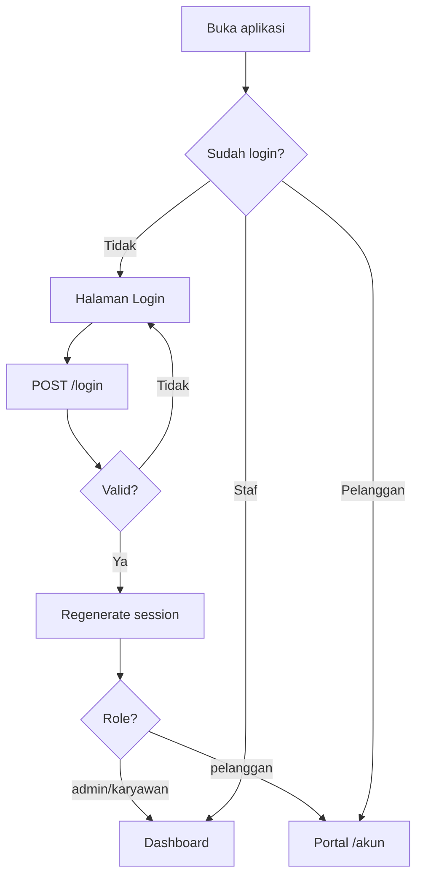
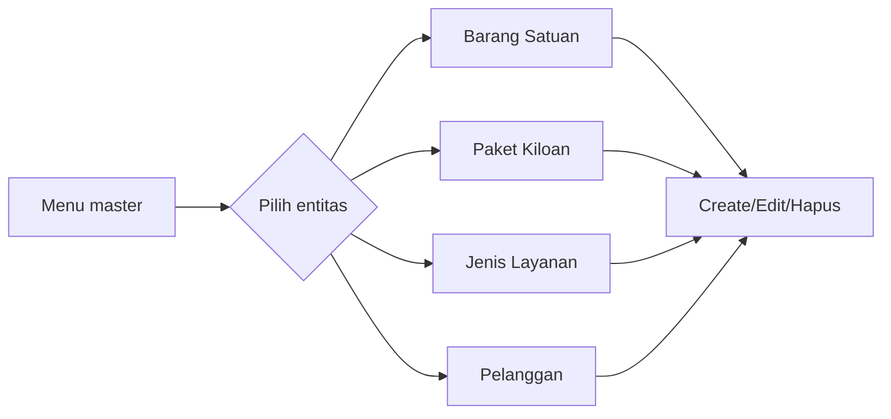
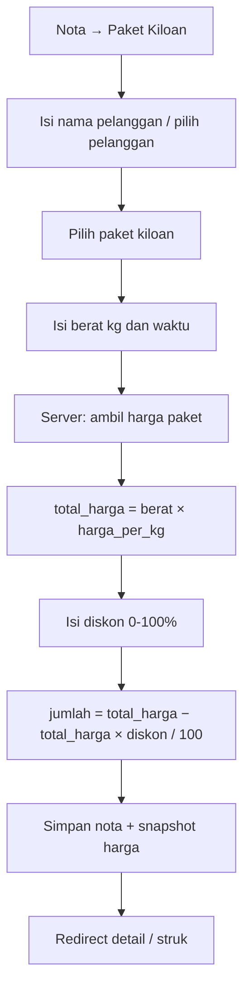
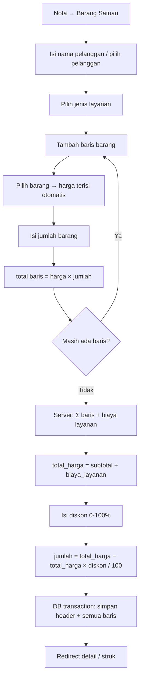
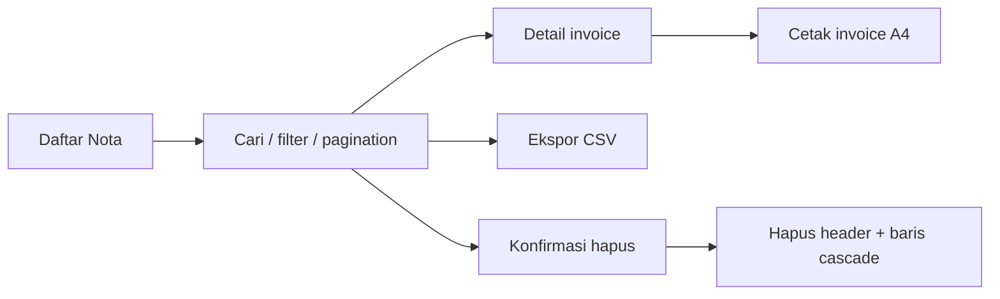
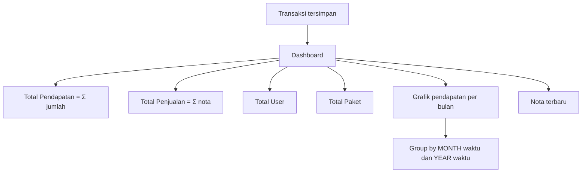

# BUSINESS WORKFLOW — Laundry Management System

Dokumen ini memetakan alur bisnis **aktual** aplikasi: aktor dan hak akses, perhitungan
transaksi, pencetakan invoice, serta konsistensi data.

## 1. Aktor dan Hak Akses

| Aktor | Role | Kemampuan |
|---|---|---|
| Administrator | `admin` | Semua: dashboard, user, karyawan, pelanggan, master, transaksi, hapus, ekspor |
| Kasir/Operator | `karyawan` | Dashboard, pelanggan, master (barang/paket/layanan), transaksi (buat/lihat/ubah/cetak), ekspor; hapus nota khusus admin |
| Pelanggan | `pelanggan` | Portal `/akun`: ringkasan + daftar nota milik sendiri, detail invoice, unduh PDF; tanpa akses halaman staf |

Aturan ini ditegakkan di server melalui Spatie Permission + Policy (staf) dan middleware
`pelanggan` + filter kepemilikan `pelanggan_id` (portal pelanggan).

## 2. Alur Login



Satu halaman login untuk semua peran. Pengguna yang sudah login dan membuka `/login` langsung
diarahkan ke tujuan sesuai perannya.

## 3. Alur Master Data (Admin/Kasir)



Aturan:
- Nama barang unik; `jenis_cuci` unik.
- Paket kiloan boleh memiliki nama sama dengan harga/deskripsi berbeda; aplikasi menampilkan
  deskripsi agar kasir dapat membedakan.
- Menghapus master tidak boleh menghapus nota historis (FK `nullOnDelete` + snapshot).
- Karyawan dikelola sebagai user role `karyawan`; pelanggan sebagai user role `pelanggan`.

## 4. Alur Transaksi Paket Kiloan



Rumus (server-side, pembulatan rupiah):

```
total_harga = round(berat × harga_per_kg)
diskon_nilai = round(total_harga × diskon / 100)
jumlah       = total_harga − diskon_nilai
```

Contoh: berat 3,5 kg × Rp25.000 = Rp87.500; diskon 10% = Rp8.750; **jumlah = Rp78.750**.
Pendapatan dashboard memakai `jumlah`.

## 5. Alur Transaksi Barang Satuan



Contoh: Kemeja 2 × Rp10.000 = Rp20.000; Celana Jeans 1 × Rp8.000 = Rp8.000;
layanan "Cepat" Rp15.000 ⇒ total_harga Rp43.000; diskon 5% = Rp2.150 ⇒ **jumlah Rp40.850**.

Aturan validasi:
- Minimal satu baris barang; jumlah barang ≥ 1.
- Barang harus ada di master; harga diambil dari master (bukan input bebas).
- Jenis layanan wajib untuk nota satuan.
- Diskon bilangan bulat 0–100.
- Perhitungan klien hanya pratinjau; server menghitung ulang.

## 6. Alur Detail, Cetak, dan Hapus Nota



- Invoice memuat: logo/nama perusahaan dari Setup, nomor, waktu, nama pelanggan, jenis, rincian
  paket/baris, harga, subtotal, diskon %, total bersih, dan terbilang Bahasa Indonesia.
- Nomor nota: `#` + 3 huruf kapital + 3 alfanumerik, dijamin unik.
- Hapus nota hanya oleh admin (permission `nota.delete`); karyawan tidak melihat tombol hapus.
  Baris ikut terhapus (cascade).
- Ekspor mempertahankan kolom legacy: No, Nomor Nota, Waktu, Jenis, Jumlah Awal, Diskon, Total Harga.

## 7. Alur Dashboard dan Laporan



Pengelompokan memakai `waktu` transaksi (bukan `created_at`) dan menampilkan tahun berjalan,
sehingga transaksi yang di-backdate masuk ke bulan yang benar.

## 8. Alur Portal Pelanggan

```mermaid
flowchart TD
    A[Pelanggan login] --> B[/akun]
    B --> C[Ringkasan: jumlah nota + total biaya]
    B --> D[Daftar nota milik sendiri]
    D --> E[Detail invoice]
    E --> F[Unduh PDF A4]
    B --> G[Buka /akun/nota/{id} pelanggan lain]
    G --> H[404]
```

Aturan:
- Data difilter `pelanggan_id = user yang login`; nota pelanggan lain tidak dapat dibuka
  maupun diunduh (404), termasuk PDF.
- PDF dibuat server-side dengan dompdf dari template A4 yang isinya setara invoice staf
  (nama perusahaan Setup, rincian item, diskon, total, terbilang). Logo tampil pada invoice web;
  PDF memuat nama perusahaan.
- Pelanggan hanya membaca dan mengunduh; tidak ada pembuatan/ubah/hapus nota.
- Staf yang membuka `/akun` dialihkan ke dashboard.

## 9. Alur Penghapusan dan Konsistensi Data

| Aksi | Aturan |
|---|---|
| Hapus nota | Header + baris terhapus (cascade), tidak memengaruhi master |
| Hapus barang/paket/layanan | Nota tetap ada; FK menjadi NULL; snapshot nama/harga di nota tetap |
| Hapus user pelanggan | Nota tetap ada; `pelanggan_id` menjadi NULL; `nama_pelanggan` snapshot dipertahankan |
| Edit nota | Hitung ulang seluruh total dari master saat ini, update header + baris dalam satu transaksi |

## 10. Matriks Skenario Uji Bisnis

1. Login admin → dashboard tampil.
2. Login karyawan → menu user/karyawan tidak tampil; transaksi bisa dibuat tetapi tombol hapus
   nota tidak tampil dan `DELETE /nota/{id}` ditolak 403.
3. Nota kiloan 3,5 kg, diskon 10% → total & jumlah sesuai rumus.
4. Nota satuan 2 baris + layanan, diskon 0% dan 100% → batas diskon benar.
5. Nota satuan tanpa baris → ditolak validasi.
6. Diskon 101 / −1 → ditolak.
7. Paket kiloan tanpa berat → ditolak.
8. Barang dengan harga diubah setelah transaksi → struk lama tetap memakai snapshot.
9. Hapus paket yang dipakai nota → nota tetap, tampil data snapshot.
10. Cetak invoice → layout A4 tanpa navigasi/tombol, terbilang sesuai total.
11. Ekspor CSV → jumlah baris = jumlah nota pada filter.
12. Pagination & pencarian server-side akurat.
13. User non-authorized mengakses route admin → 403.
14. Guest mengakses dashboard → redirect login.
15. Lupa password: email terdaftar menerima tautan; email tak terdaftar tetap pesan generik;
    token sekali pakai; login dengan kata sandi baru berhasil.
16. Setup: admin mengubah nama + logo → invoice dan brand sidebar ikut berubah; karyawan 403.
17. Login pelanggan → diarahkan ke `/akun`; ringkasan dan daftar hanya memuat nota miliknya.
18. Pelanggan membuka detail/PDF nota milik pelanggan lain → 404.
19. Unduh PDF nota pelanggan → respons `application/pdf`, file dapat dibuka dan isinya sama
    dengan invoice (termasuk terbilang).
20. Staf membuka `/akun` → dialihkan ke dashboard; pelanggan membuka `/nota` → 403.
