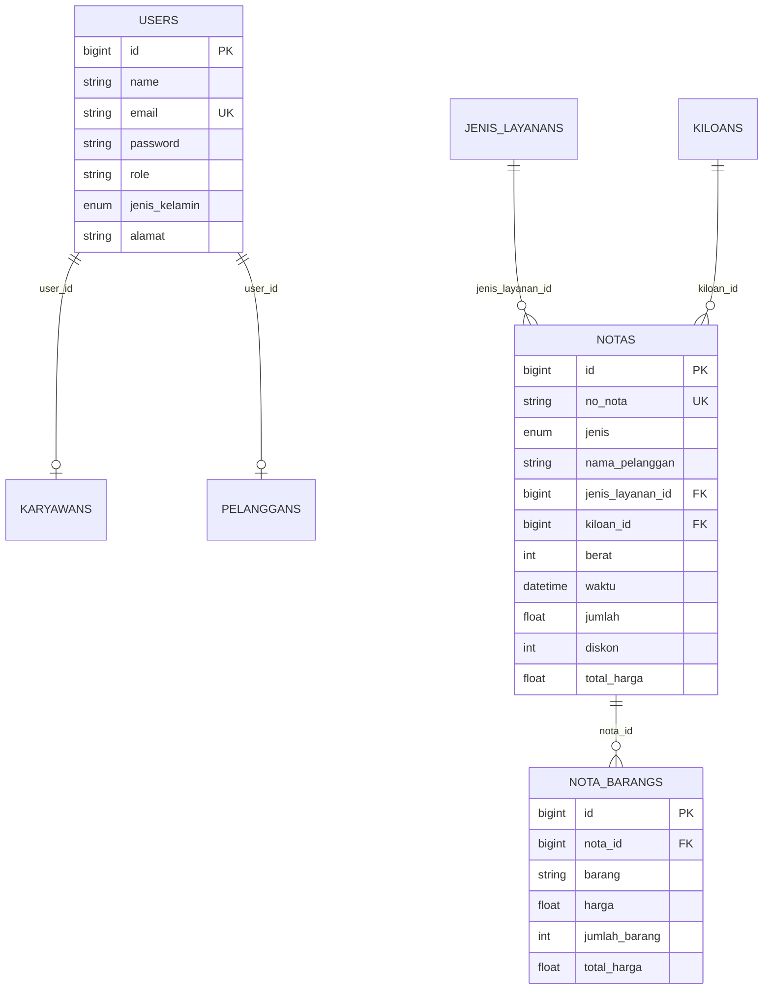
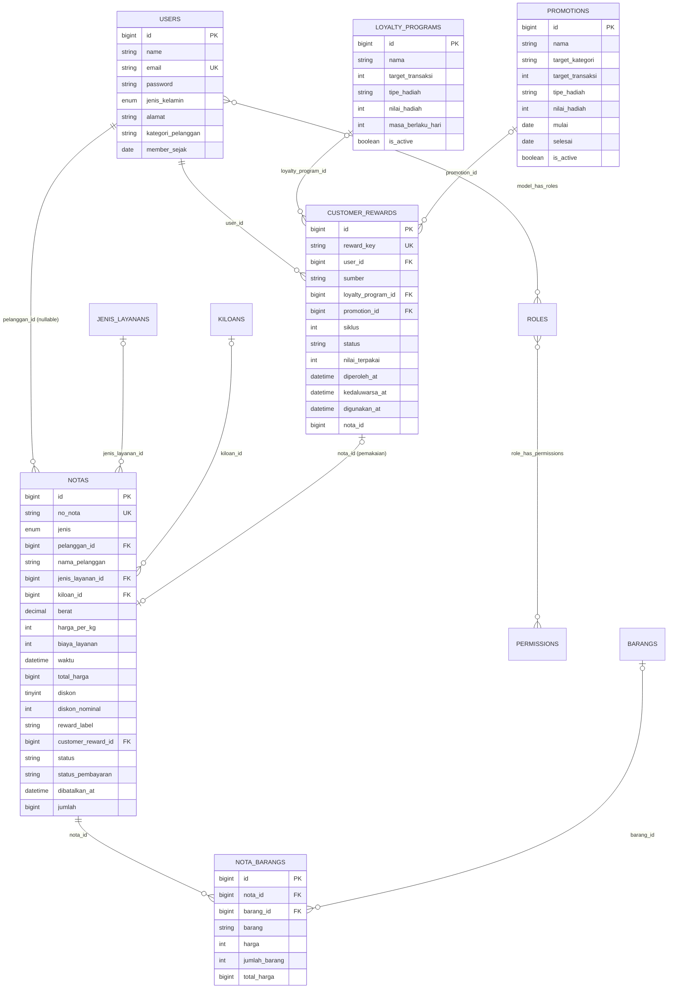

# DATABASE ANALYSIS — Legacy vs Aplikasi Baru

## 1. Tabel Legacy (hasil verifikasi migration + model + query)

### 1.1 `users`
| Kolom | Tipe | Constraint |
|---|---|---|
| id | bigint unsigned | PK |
| name | varchar(255) | not null |
| email | varchar(255) | unique |
| password | varchar(255) | not null |
| role | varchar(255) | not null (nilai: `Admin`, `Karyawan`, `Pelanggan`) |
| jenis_kelamin | enum(`Laki-Laki`,`Perempuan`) | not null |
| alamat | varchar(255) | nullable |
| email_verified_at | timestamp | nullable |
| remember_token | varchar(100) | nullable |
| created_at / updated_at | timestamp | |

### 1.2 `karyawans`
| Kolom | Tipe | Constraint |
|---|---|---|
| id | bigint unsigned | PK |
| user_id | bigint unsigned | FK → users.id, cascade |
| created_at / updated_at | timestamp | |

Tidak menyimpan data tambahan apa pun (wrapper 1:1 untuk menandai user karyawan).

### 1.3 `pelanggans`
Struktur identik dengan `karyawans`, FK → users.id cascade. Juga wrapper 1:1.

### 1.4 `barangs`
| Kolom | Tipe | Constraint |
|---|---|---|
| id | bigint unsigned | PK |
| name | varchar(255) | unique |
| harga | int | not null (rupiah) |
| timestamps | | |

### 1.5 `kiloans`
| Kolom | Tipe | Constraint |
|---|---|---|
| id | bigint unsigned | PK |
| paket | varchar(255) | not null |
| harga | int | not null (rupiah/kg) |
| description | varchar(255) | nullable |
| timestamps | | |

### 1.6 `jenis_layanans`
| Kolom | Tipe | Constraint |
|---|---|---|
| id | bigint unsigned | PK |
| jenis_cuci | varchar(255) | unique |
| waktu | varchar(255) | not null (contoh "180 Menit") |
| harga | int | not null (biaya layanan) |
| timestamps | | |

### 1.7 `notas`
| Kolom | Tipe | Constraint |
|---|---|---|
| id | bigint unsigned | PK |
| no_nota | varchar(255) | unique |
| jenis | enum(`Barang Satuan`,`Paket Kiloan`) | not null |
| nama_pelanggan | varchar(255) | not null (teks bebas, bukan FK) |
| jenis_layanan_id | bigint unsigned | nullable, FK → jenis_layanans.id, cascade |
| kiloan_id | bigint unsigned | nullable, FK → kiloans.id, cascade |
| berat | int | nullable |
| waktu | datetime | not null |
| jumlah | float | not null (nilai bersih setelah diskon) |
| diskon | int | not null (persen) |
| total_harga | float | not null (nilai bruto sebelum diskon) |
| timestamps | | |

Catatan: `ON DELETE CASCADE` pada master menyebabkan nota historis ikut terhapus bila master dihapus.

### 1.8 `nota_barangs`
| Kolom | Tipe | Constraint |
|---|---|---|
| id | bigint unsigned | PK |
| nota_id | bigint unsigned | FK → notas.id, cascade |
| barang | varchar(255) | not null (nama snapshot, bukan FK) |
| harga | float | not null |
| jumlah_barang | int | not null |
| total_harga | float | not null |
| timestamps | | |

### 1.9 Tabel bawaan Laravel
`password_reset_tokens`, `failed_jobs`, `personal_access_tokens` (Sanctum).

## 2. Relationship Map (Legacy)

```
users 1 ──── 0..1 karyawans        (user_id, cascade)
users 1 ──── 0..1 pelanggans       (user_id, cascade)
users 1 ──── * notas?              (TIDAK ADA FK — hanya nama_pelanggan teks)

jenis_layanans 1 ──── * notas      (nullable, cascade)
kiloans        1 ──── * notas      (nullable, cascade)
notas          1 ──── * nota_barangs (cascade)

barangs        * ──── ? notas      (model salah: hasMany tanpa FK)
nota_barangs   * ──── 1 notas      (nota_id)
```

### ERD Legacy (Mermaid)



## 3. Masalah Integritas Data Legacy

1. **Tidak ada relasi nota → pelanggan**; `nama_pelanggan` bebas teks sehingga ejaan bisa berbeda
   untuk orang yang sama dan histori per pelanggan tidak mungkin dihitung.
2. **`ON DELETE CASCADE` dari master ke nota** menghapus riwayat transaksi saat master dihapus.
3. **Harga tidak di-snapshot**: detail nota menampilkan harga master saat ini, bukan harga saat
   transaksi dibuat. Perubahan harga merusak struk lama.
4. **`nota_barangs.barang` berupa string**, bukan FK; rename barang memutus hubungan dan
   statistik pie dihitung berdasarkan string nama (`where('barang', $barang->name)`).
5. **Uang bertipe float** pada notas/nota_barangs, rawan pembulatan.
6. **Tidak ada index laporan** (created_at/waktu/jenis/nama_pelanggan).
7. **Diskon tidak dibatasi** 0–100.
8. **Tabel wrapper** `karyawans`/`pelanggans` menduplikasi `users.role`.
9. `users.role` berupa string bebas (tidak ada constraint/enum).
10. Tidak ada soft delete; penghapusan permanen.

## 4. Desain Database Aplikasi

Prinsip: mempertahankan seluruh informasi & perilaku bisnis, menormalkan relasi, menambah
snapshot historis, memperbaiki tipe uang, dan menambah index laporan.

### 4.1 Daftar Tabel Baru

| Tabel | Perubahan dari legacy |
|---|---|
| `users` | `role` dihapus → Spatie roles (`admin`, `karyawan`, `pelanggan`); `jenis_kelamin`, `alamat` dipertahankan; + `kategori_pelanggan` enum (`reguler`/`member`) dan `member_sejak` |
| `karyawans` | **Dihapus** (redundan; karyawan = user dengan role `karyawan`) |
| `pelanggans` | **Dihapus** (pelanggan = user dengan role `pelanggan`) |
| `barangs` | Sama; `harga` menjadi unsigned int; index nama tetap unique |
| `kiloans` | Sama; `harga` unsigned int |
| `jenis_layanans` | Sama; `harga` unsigned int |
| `notas` | + `pelanggan_id` nullable FK → users (nullOnDelete); + snapshot `harga_per_kg`, `biaya_layanan`; `berat` decimal(8,2); uang unsigned bigint; diskon 0–100; index laporan; + `status`, `status_pembayaran`, `dibatalkan_at`, `diskon_nominal`, `reward_label`, `customer_reward_id` |
| `nota_barangs` | + `barang_id` nullable FK → barangs (nullOnDelete); `barang` tetap sebagai snapshot nama; uang unsigned int |
| `loyalty_programs` | **Baru** — konfigurasi program loyalitas Member |
| `promotions` | **Baru** — konfigurasi promosi umum (Reguler/Member) |
| `customer_rewards` | **Baru** — ledger hadiah loyalitas & promosi per pelanggan |
| `roles/permissions/...` | Tabel Spatie Permission |
| `sessions`, `cache`, `jobs` | Tabel bawaan Laravel 13 (driver database) |

### 4.2 Detail Tabel Baru

#### `users`
`id`, `name`, `email` (unique), `password`, `jenis_kelamin` enum nullable,
`alamat` varchar nullable, `kategori_pelanggan` varchar(20) default `Reguler`
(nilai `Reguler`/`Member`, enum aplikasi), `member_sejak` date nullable,
`email_verified_at`, `remember_token`, timestamps. Index `kategori_pelanggan`.

#### `notas` (inti)
| Kolom | Tipe | Keterangan |
|---|---|---|
| id | bigint unsigned PK | |
| no_nota | varchar(20) unique | `#` + 3 huruf + 3 alfanumerik |
| jenis | enum(`Barang Satuan`,`Paket Kiloan`) | |
| pelanggan_id | bigint nullable FK users | nullOnDelete; opsional dipilih dari master |
| nama_pelanggan | varchar(255) | snapshot teks (kompatibel legacy) |
| jenis_layanan_id | bigint nullable FK jenis_layanans | nullOnDelete |
| kiloan_id | bigint nullable FK kiloans | nullOnDelete |
| berat | decimal(8,2) nullable | kg; boleh pecahan |
| harga_per_kg | unsigned int nullable | snapshot harga paket saat transaksi |
| biaya_layanan | unsigned int default 0 | snapshot biaya layanan saat transaksi |
| waktu | datetime | waktu transaksi (dipakai laporan) |
| subtotal? | — | Tidak ditambah; `total_harga` tetap bruto |
| total_harga | unsigned bigint | bruto sebelum diskon |
| diskon | unsigned tinyint | persen 0–100; dipaksa 0 bila memakai hadiah |
| diskon_nominal | unsigned int default 0 | potongan rupiah aktual (diskon atau hadiah) |
| reward_label | varchar nullable | label hadiah yang dipakai |
| customer_reward_id | bigint nullable FK customer_rewards | nullOnDelete |
| status | varchar(20) default `Diproses` | `Diproses`/`Selesai`/`Dibatalkan` (enum aplikasi) |
| status_pembayaran | varchar(20) default `Belum Lunas` | `Belum Lunas`/`Lunas` |
| dibatalkan_at | datetime nullable | waktu pembatalan |
| jumlah | unsigned bigint | netto setelah diskon/hadiah (dasar pendapatan) |
| timestamps | | |

Index: `no_nota` unique, `created_at`, `waktu`, `jenis`, `nama_pelanggan`, `pelanggan_id`,
`status`, `status_pembayaran`.

#### `loyalty_programs`
`id`, `nama` varchar(100), `deskripsi` text nullable, `target_transaksi` unsigned smallint,
`tipe_hadiah` varchar(20) default `persen` (`persen`/`nominal`/`gratis`), `nilai_hadiah`
unsigned int, `masa_berlaku_hari` unsigned smallint nullable, `is_active` boolean default true,
timestamps. Hanya program aktif terbaru yang dipakai.

#### `promotions`
`id`, `nama` varchar(100), `deskripsi` text nullable, `syarat` text nullable,
`target_kategori` varchar(20) nullable (`Reguler`/`Member`/null = semua), `target_transaksi`
unsigned smallint, `tipe_hadiah` varchar(20), `nilai_hadiah` unsigned int, `mulai` date nullable,
`selesai` date nullable, `is_active` boolean default true, timestamps. Index
`(is_active, mulai, selesai)` dan `target_kategori`.

#### `customer_rewards`
| Kolom | Tipe | Keterangan |
|---|---|---|
| id | bigint unsigned PK | |
| reward_key | varchar(80) unique | `LOY-{program}-{user}-{siklus}` / `PRM-{promo}-{user}-{siklus}`; kunci idempotensi |
| user_id | bigint FK users | cascadeOnDelete |
| sumber | varchar(20) | `loyalitas` / `promosi` |
| loyalty_program_id | bigint nullable FK loyalty_programs | nullOnDelete |
| promotion_id | bigint nullable FK promotions | nullOnDelete |
| siklus | unsigned smallint | siklus ke-1, 2, … |
| label | varchar(150) | nama program/promosi |
| tipe_hadiah | varchar(20) | `persen`/`nominal`/`gratis` |
| nilai_hadiah | unsigned int | nilai konfigurasi |
| status | varchar(20) default `Tersedia` | `Tersedia`/`Digunakan`/`Kedaluwarsa`/`Dibatalkan` |
| nilai_terpakai | unsigned int default 0 | potongan rupiah saat dipakai |
| diperoleh_at | datetime | waktu terbit |
| kedaluwarsa_at | datetime nullable | batas pakai (loyalitas; null untuk promosi) |
| digunakan_at | datetime nullable | waktu dipakai |
| nota_id | bigint nullable | nota tempat hadiah dipakai (tanpa FK keras, divalidasi aplikasi) |
| timestamps | | |

Index: `(user_id, status)`, `(sumber, status)`, `nota_id`.

#### `nota_barangs`
`id`, `nota_id` FK cascade, `barang_id` nullable FK barangs nullOnDelete,
`barang` varchar snapshot, `harga` unsigned int, `jumlah_barang` unsigned int,
`total_harga` unsigned bigint, timestamps. Index `nota_id`.

### 4.3 ERD Aplikasi (Mermaid)



### 4.4 Aturan Integritas Baru

1. Semua nilai uang dihitung ulang di server; input klien diabaikan.
2. Diskon divalidasi 0–100 dengan pembulatan rupiah `round()`.
3. Jenis nota menentukan field wajib: `Paket Kiloan` ⇒ `kiloan_id` + `berat`; `Barang Satuan`
   ⇒ `jenis_layanan_id` + minimal 1 baris barang.
4. Harga satuan, harga per kg, dan biaya layanan diambil dari master saat penyimpanan dan
   disimpan sebagai snapshot.
5. Transaksi berjalan dalam `DB::transaction` (header + baris).
6. Master yang dihapus tidak menghapus nota (nullOnDelete).
7. Soft delete master tidak dipakai (legacy tidak memakainya). Master yang sudah dipakai transaksi
   tetap boleh dihapus; FK `nullOnDelete` dan snapshot pada nota menjaga riwayat tetap utuh.
8. `pelanggan_id` boleh kosong untuk kompatibilitas transaksi walk-in.
9. `customer_rewards.reward_key` unique + deterministik menjadi kunci idempotensi penerbitan
   hadiah: satu hadiah per program/promosi, per pelanggan, per siklus.
10. Penghasilan hadiah hanya dari transaksi berstatus `Selesai`; pembatalan/penghapusan transaksi
    menurunkan hitungan dan mencabut hadiah `Tersedia` yang siklusnya tidak lagi valid
    (`Dibatalkan`), sedangkan hadiah yang sudah dipakai tidak ditarik.
11. Satu nota maksimal memakai satu hadiah (`customer_reward_id`); hadiah harus milik pelanggan
    nota dan berstatus `Tersedia`. Pemakaian mengisi `status = Digunakan`, `digunakan_at`,
    `nilai_terpakai`, dan `nota_id` dalam transaksi database yang sama dengan penyimpanan nota.
12. `diskon` manual dipaksa 0 saat hadiah dipakai; `jumlah = total_harga − diskon_nominal`
    (tidak negatif) sehingga tidak ada potongan berganda.
13. Hadiah kedaluwarsa dihitung saat sinkronisasi (`kedaluwarsa_at <= now`) dan tidak dapat dipakai;
    hadiah promosi tidak memiliki tanggal kedaluwarsa, tetapi penerbitan barunya berhenti saat
    promosi nonaktif/keluar periode.
14. `promotions.target_kategori` null berarti semua kategori; nilai lain dibatasi enum aplikasi
    `Reguler`/`Member`. Kategori pelanggan disimpan di `users.kategori_pelanggan` dengan index
    untuk filter.

## 5. Verifikasi Implementasi (2026-11-27)

Skema di atas diverifikasi langsung terhadap migration dan database berjalan:

| Migration | Tabel |
|---|---|
| `0001_01_01_000000_create_users_table` | `users`, `password_reset_tokens`, `sessions` |
| `0001_01_01_000001_create_cache_table` | `cache`, `cache_locks` |
| `0001_01_01_000002_create_jobs_table` | `jobs`, `job_batches`, `failed_jobs` |
| `2026_11_24_121457_create_permission_tables` | 5 tabel Spatie (roles, permissions, pivot) |
| `2026_11_24_130001_create_barangs_table` | `barangs` |
| `2026_11_24_130002_create_kiloans_table` | `kiloans` |
| `2026_11_24_130003_create_jenis_layanans_table` | `jenis_layanans` |
| `2026_11_24_130004_create_notas_table` | `notas` |
| `2026_11_24_130005_create_nota_barangs_table` | `nota_barangs` |
| `2026_11_26_100001_add_kategori_to_users_table` | + `users.kategori_pelanggan`, `users.member_sejak` |
| `2026_11_26_100002_create_loyalty_programs_table` | `loyalty_programs` |
| `2026_11_26_100003_create_promotions_table` | `promotions` |
| `2026_11_26_100004_create_customer_rewards_table` | `customer_rewards` |
| `2026_11_26_100005_add_status_and_reward_to_notas_table` | + `notas.status`, `status_pembayaran`, `diskon_nominal`, `reward_label`, `customer_reward_id`, `dibatalkan_at`; index status/pembayaran |

Fakta yang dicek:

- `notas.no_nota` varchar(20) unique; `jenis` enum dua nilai; `pelanggan_id`,
  `jenis_layanan_id`, `kiloan_id` nullable dengan `nullOnDelete`; `customer_reward_id` nullable
  `nullOnDelete`.
- `notas.berat` decimal(8,2); `total_harga`/`jumlah` unsigned bigint; `diskon` unsigned tinyint;
  `status`/`status_pembayaran` varchar dengan default `Diproses`/`Belum Lunas`.
- Index `waktu`, `jenis`, `nama_pelanggan`, `status`, `status_pembayaran` ada.
- `nota_barangs.nota_id` cascade; `barang_id` nullable `nullOnDelete`; snapshot `barang` + `harga`.
- `users` menyimpan `jenis_kelamin`, `alamat`, `kategori_pelanggan` (default `Reguler`, index),
  dan `member_sejak`; peran ada di tabel Spatie.
- `customer_rewards.reward_key` unique; `user_id` cascade; `loyalty_program_id`/`promotion_id`
  nullable `nullOnDelete`; index `(user_id, status)`, `(sumber, status)`, `nota_id`.
- `promotions` memiliki index `(is_active, mulai, selesai)` dan `target_kategori`.
- Hasil `migrate --seed` pada database baru (27 November 2026): 15 user (1 admin, 4 karyawan,
  5 Member, 5 Reguler), 10 barang, 5 kiloan, 4 layanan, 1 program loyalitas, 3 promosi, 81 nota
  (ID 1–81), 18 riwayat hadiah, 3 role, 14 permission. `db:seed` ulang tidak mengubah jumlah
  nota/hadiah (idempoten).
- Database demo `laundry_svelte` dan test `laundry_svelte_test` dibuat ulang dari nol dengan
  `DROP DATABASE` + `CREATE DATABASE`, lalu seluruh 17 migrasi dijalankan ulang; detail baseline
  ada di `TESTING_REPORT.md` §4.6. Database proyek lain dan database produksi tidak disentuh.
- Test database terpisah `laundry_svelte_test` dipakai oleh PHPUnit (`RefreshDatabase`).
